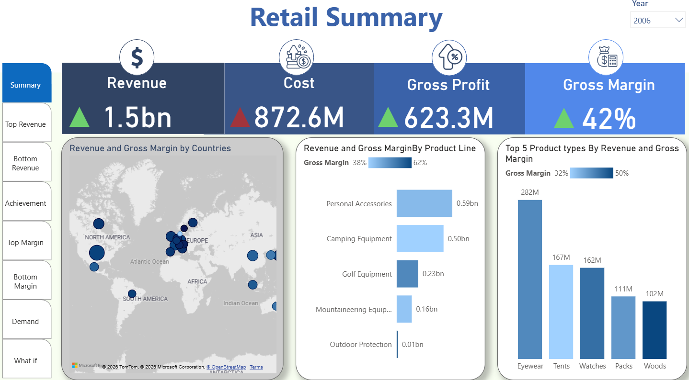
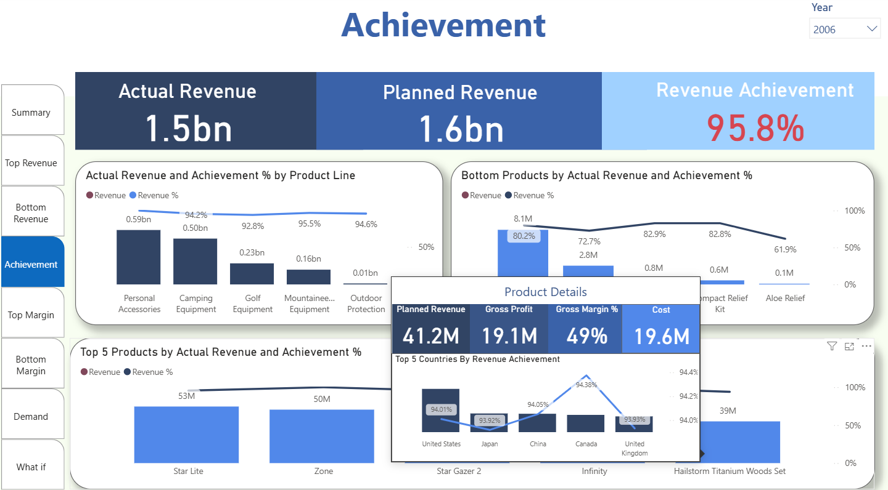
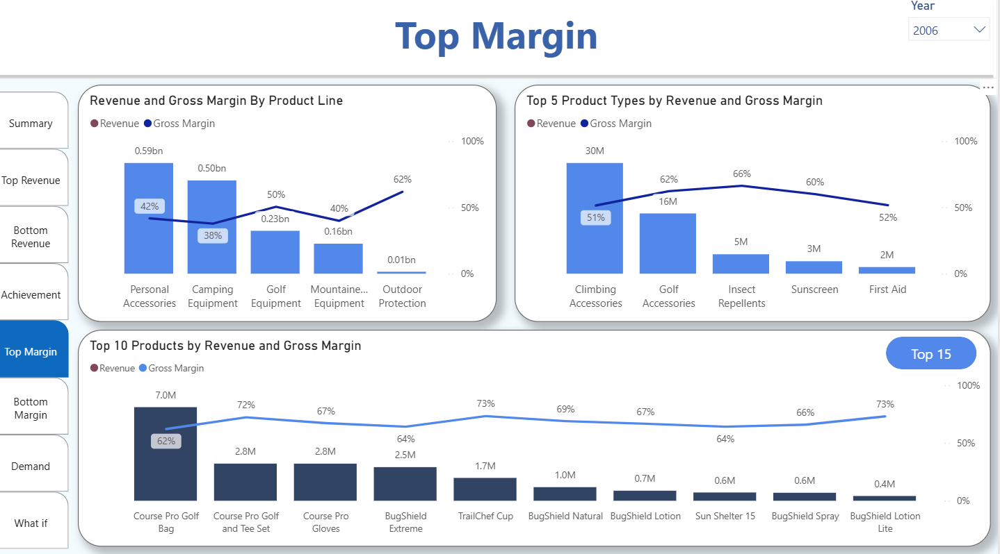
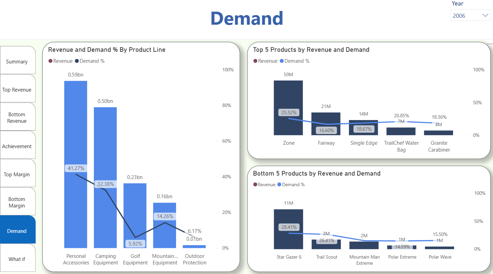
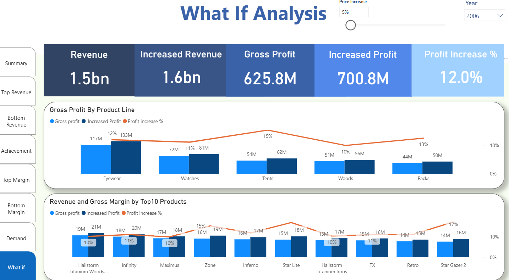

# Retail Sales Performance Dashboard

Power BI retail analytics project focused on **revenue performance, gross margin, product demand, revenue achievement, and pricing what-if analysis**.

**Power BI · DAX · Power Query · Excel · Retail Analytics**

## Project Overview

The report transforms retail sales data into an interactive analytical dashboard for evaluating revenue, cost, gross profit, product performance, demand, and pricing scenarios across product lines and countries.

## Report Pages

### Retail Summary

Executive overview of **Revenue, Cost, Gross Profit, and Gross Margin**, with geographic revenue distribution, product-line performance, and leading product types.



### Achievement

**Actual Revenue vs. Planned Revenue** analysis, including overall revenue achievement, product-line comparisons, top-performing products, and country-level performance.



### Top Margin

Analysis of **Revenue and Gross Margin** across product lines, product types, and top-performing products.



### Demand

Product demand analysis highlighting **Revenue and Demand %** across product lines, top products, and bottom products.



### What If Analysis

Interactive pricing scenario analysis exploring how a **price increase** changes modeled revenue and profit across products and product lines.



## Business Questions

The report is designed to answer questions such as:

- Which product lines and product types generate the highest revenue?
- How does actual revenue compare with planned revenue?
- Which products and product lines deliver the strongest gross margins?
- How does product demand differ across categories?
- Which products contribute most and least to revenue?
- How does a pricing scenario affect projected revenue and profit?
- Which countries contribute most to retail performance?

## Key Measures

Examples of analytical measures used in the report include:

- Revenue
- Revenue YoY %
- Gross Profit
- Gross Margin
- Planned Revenue
- Cost
- Quantity Sold
- Popularity %
- New Revenue
- New Net Profit
- Increased Profit
- Profit Increase %

## Report Features

- Executive KPI cards
- Revenue and gross margin analysis
- Product and product-line performance
- Top and bottom product comparisons
- Actual vs. planned revenue analysis
- Country-level performance
- Demand analysis
- Interactive price increase what-if scenario
- Dynamic year filtering
- Detailed report tooltips

## Tools & Technologies

- **Power BI Desktop**
- **DAX**
- **Power Query**
- **Microsoft Excel**
- **What-If Parameters**
- **Retail KPI Analysis**

## Repository Structure

```text
retail-sales-performance-dashboard/
├── README.md
├── dashboard/
│   └── Retail Dashboard.pbix
├── data/
│   └── WA_Retail-SalesMarketing_-ProfitCost.xlsx
├── images/
│   ├── retail-summary.png
│   ├── achievement.png
│   ├── top-margin.png
│   ├── demand.png
│   └── what-if-analysis.png
└── docs/
    ├── report-pages.md
    └── measures.md
```

## Files

- `dashboard/Retail Dashboard.pbix` — Power BI report
- `data/WA_Retail-SalesMarketing_-ProfitCost.xlsx` — retail source dataset
- `docs/report-pages.md` — report page overview
- `docs/measures.md` — measure inventory

## Author

**Omar Ali**  
Data Engineering · Analytics Engineering

[LinkedIn](https://www.linkedin.com/in/eng-omargomaa) · [GitHub](https://github.com/omaraligomaa)
